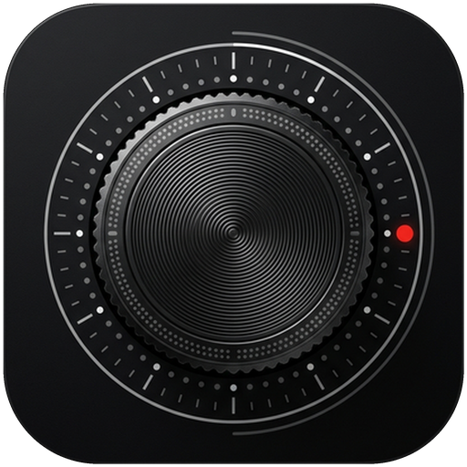
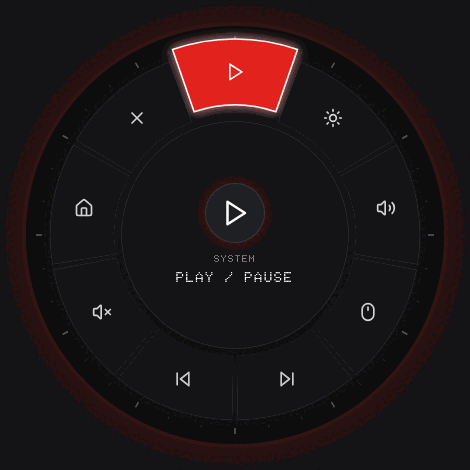
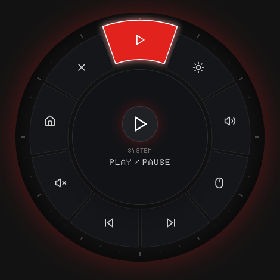
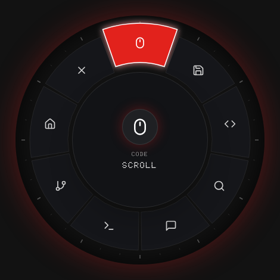
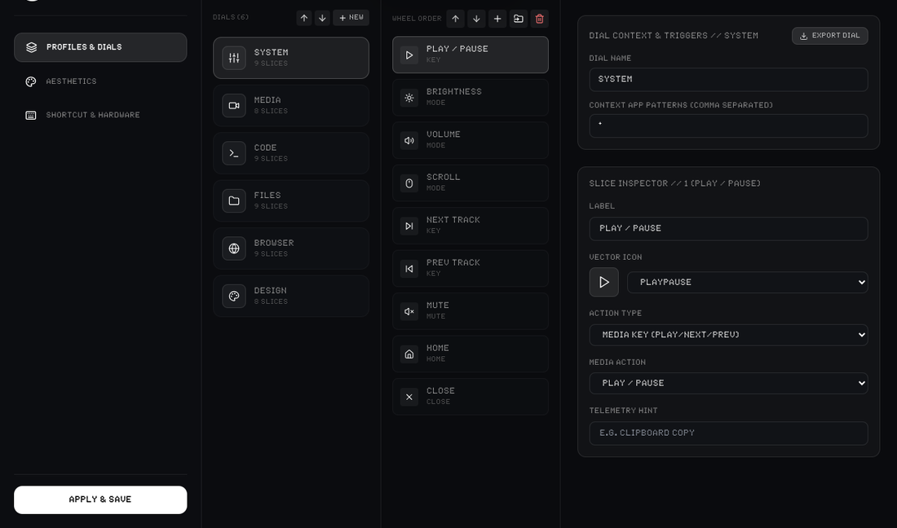
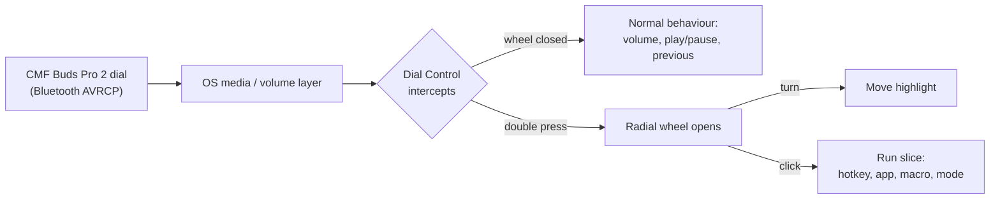

<div align="center">



# Dial Control

**A context-aware radial menu for Linux, Windows and macOS, driven by the CMF Buds Pro 2 dial or a keyboard shortcut. Launch apps, run shortcuts and macros, scroll, and control volume and brightness from one wheel.**

[](LICENSE)
[](https://v2.tauri.app/)
[](https://www.rust-lang.org/)
[](https://react.dev/)


[Install](#install-in-one-line) · [Features](#features) · [Keyboard](#keyboard-controls) · [How it works](#how-it-works) · [Build from source](#build-from-source) · [FAQ](#faq) · [Docs](#documentation) · [Contributing](#contributing)

</div>

---

## Install in one line

**Linux and macOS**

```bash
curl -fsSL https://github.com/Yuvraj675/dial-control/releases/latest/download/install.sh | bash
```

**Windows** (PowerShell)

```powershell
irm https://github.com/Yuvraj675/dial-control/releases/latest/download/install.ps1 | iex
```

It detects your OS and Linux distribution, downloads the right package from the latest release, **verifies its SHA-256 checksum** and installs it. No earbuds? It works with a keyboard shortcut too. Other ways to install, options and a review-first path are in [Install](#install).

---

<div align="center">
  
  <br /><sub>Turning the dial moves the highlight; a click runs the slice.</sub>
</div>

Dial Control behaves like normal earbuds until you ask for more. **Double-press the dial** (or hit a shortcut) and an animated donut-shaped wheel appears with actions chosen for the app you are using. Turn the dial to move the highlight, click to run it. Inspired by [KnifeLemon/Filee](https://github.com/KnifeLemon/Filee).

> **Independent project.** Dial Control is not affiliated with, endorsed by or connected to Nothing Technology Limited. "CMF", "Nothing" and "Nothing X" are trademarks of their respective owners and are used only to describe compatible hardware and software.

## Features

- **Normal earbuds by default**: with the wheel closed, turn = volume, click = play/pause, triple press = previous track.
- **Context-aware wheels**: the wheel switches profile for the foreground app (files, video, code editor, browser, design, system…). A **Home** slice opens a switcher for any profile.
- **Scroll mode**: the dial becomes a mouse wheel for long pages, code and short-video feeds, with no focus loss. A red tray icon, a GNOME top-bar pill and a tone show that it is active.
- **Volume and brightness gauges**: live brightness on laptop panels (including OLED laptops via GNOME Mutter), external monitors (DDC/CI) and macOS displays.
- **Stateful volume locking**: your listening volume stays untouched while you navigate the wheel and is restored when it closes.
- **Custom slices and macros**: a slice can press a hotkey, open an app/file/URL, run a command, type text, or chain these with waits into a macro. A *Test run* button tries it after a 3 s countdown.
- **Custom profiles**: build your own wheels with icons, title/class matching rules and slices imported from other profiles.
- **Works without earbuds**: a global shortcut, arrow keys and the mouse wheel drive the whole wheel from a keyboard. See [Keyboard controls](#keyboard-controls).
- **Lightweight tray daemon**: Rust + Tauri, single instance, hot-reloaded settings.

## Keyboard controls

You do **not** need the CMF Buds Pro 2. Everything the dial does is also available from the keyboard and mouse, so Dial Control works as a radial app launcher and shortcut palette for anyone:

| Input | Action |
|---|---|
| **`Super+Shift+D`** (Windows: `Win+Shift+D`, macOS: `Cmd+Shift+D`) | Open / close the wheel anywhere. Rebind it in *Settings → Shortcut & Hardware* |
| `→` `↓` or mouse wheel down | Next slice |
| `←` `↑` or mouse wheel up | Previous slice |
| `Enter` or `Space` | Run the highlighted slice |
| `Esc` | Close the wheel, or leave the current gauge mode |

What you get without earbuds:
- **Context-aware wheels**: a different set of slices for your editor, browser, file manager and more.
- **Your own slices**: hotkeys, app and URL launchers, shell commands, text snippets and multi-step macros, all one keypress away.
- **Volume and brightness gauges**: open the wheel, pick *Volume* or *Brightness*, then use the arrow keys or mouse wheel.
- **Any input device**: anything that can send the shortcut and arrow keys, such as a macro pad, drives the wheel the same way.

On Linux/Wayland the shortcut is registered through GNOME's compositor keybindings and reaches the app through a local socket in under 2 ms; on other desktops it is a normal global shortcut. You can also trigger the wheel from a script or keybinding with `dial-control --toggle`.

## Screenshots

| System wheel | Code & Editor wheel |
|:---:|:---:|
|  |  |

The wheel changes with the app in front of you. Profiles, slices, icons and shortcuts are edited in the Settings window:



## Platform support

| Platform | Dial input | Volume | Brightness | Context detection | Status |
|---|---|---|---|---|---|
| **Linux** (X11 / Wayland) | BlueZ D-Bus + `evdev` exclusive grab | WirePlumber / PulseAudio | Mutter D-Bus, `/sys/class/backlight` | GNOME Shell extension, Hyprland, Sway, KDE, X11 | Functional |
| **Windows** 10 / 11 | Core Audio callback, `WH_KEYBOARD_LL`, Raw Input, own SMTC session | WASAPI | DDC/CI (`dxva2`) + WMI | Win32 foreground window | Functional |
| **macOS** 14+ (Apple Silicon) | CoreGraphics event tap, CoreAudio listener, own Now Playing session | CoreAudio | DisplayServices | `NSWorkspace` + AppleScript | Functional |
| **Android** 8.0+ | Own `MediaSession` + `STREAM_MUSIC` watcher | `AudioManager` | `Settings.System` | Accessibility service | **Coming soon** (work in progress, no release yet) |

Windows and macOS decision logic is unit-tested on any host; the OS integrations themselves are verified by compilation in CI-style checks, so field reports are welcome (see [Troubleshooting](#troubleshooting)).

## Install

### One-line installer

The [one-line commands at the top](#install-in-one-line) pick the right package for your system: `.deb` via apt, `.rpm` via dnf/zypper, `.pkg.tar.zst` via pacman, otherwise the portable AppImage on Linux; the `.dmg` into Applications on macOS; the per-user setup on Windows. Nothing is installed if the checksum does not match.

<details>
<summary>Options and reviewing the script first</summary>

```bash
# read it before running it
curl -fsSL https://github.com/Yuvraj675/dial-control/releases/latest/download/install.sh -o install.sh
less install.sh && bash install.sh

# specific version / force the AppImage / download and verify only
curl -fsSL https://github.com/Yuvraj675/dial-control/releases/latest/download/install.sh | bash -s -- --version 1.0.0
bash install.sh --appimage
bash install.sh --dry-run
```
```powershell
$env:DIAL_CONTROL_VERSION = "1.0.0"; irm https://github.com/Yuvraj675/dial-control/releases/latest/download/install.ps1 | iex
```
Needs `curl` (or `wget`) and `sudo` on Linux. The scripts live in [`scripts/`](scripts/install.sh) and are attached to every release.
</details>

### Manual download

Prefer to do it yourself? Download the package for your OS from [Releases](https://github.com/Yuvraj675/dial-control/releases) (built by GitHub Actions on every version tag; maintainers: see the [release guide](docs/DEVELOPMENT_GUIDE.md#8-creating-a-release-automated)) and follow the steps below.

### Earbuds setup (all platforms, optional)

The CMF Buds Pro 2 dial uses standard Bluetooth **AVRCP**, not a proprietary protocol. In your earbuds' companion app (for the CMF Buds Pro 2 that is the **Nothing X** app, under *Controls → Dial*) set:

| Gesture | Setting |
|---|---|
| Double press | **Next track** |
| Triple press | **Previous track** |

The earbuds send those commands and Dial Control reads them as "open the wheel" and "previous track".

### Linux

| Distribution | Package | Command |
|---|---|---|
| Debian / Ubuntu 24.04+ / Pop!_OS / Mint | `.deb` | `sudo dpkg -i dial-control_1.0.0_amd64.deb` |
| Fedora 40+ / Nobara / openSUSE | `.rpm` | `sudo dnf install ./dial-control-1.0.0-1.x86_64.rpm` |
| Arch / Manjaro / EndeavourOS | `.pkg.tar.zst` | `sudo pacman -U ./dial-control-1.0.0-1-x86_64.pkg.tar.zst` |
| Any distribution | `.AppImage` | `chmod +x Dial-Control-1.0.0-amd64.AppImage && ./Dial-Control-1.0.0-amd64.AppImage` |

Packages install the binary, desktop entry, icon, a `udev` rule (non-root access to `/dev/uinput` and the dial's input node) and the GNOME Shell *focused-window* extension.

- Requires **glibc ≥ 2.39** (Ubuntu 24.04+, Fedora 40+, current Arch). Ubuntu 22.04 / Debian 12 are not supported.
- **GNOME on Wayland**: log out and back in once so GNOME Shell loads the extension.
- **Already-connected earbuds**: disconnect and reconnect them once so the new permissions attach.
- **AppImage**: run `bash scripts/setup_udev.sh` once, or add your user to the `input` group.
- **Tiling compositors**: see [Tiling window managers](#tiling-window-managers) for float rules.

### Windows

Download `Dial Control_1.0.0_x64-setup.exe` (per-user NSIS installer, no admin rights) or the `.msi`. Requires the WebView2 runtime (preinstalled on Windows 11).

### macOS

The release `.dmg` is built for **Apple Silicon**; Intel Macs can build from source. Download the `.dmg` and drag **Dial Control** to *Applications*. The app is ad-hoc signed, not notarized, so remove the quarantine flag once:

```bash
xattr -dr com.apple.quarantine "/Applications/Dial Control.app"
```

Then grant **Accessibility** access under *System Settings → Privacy & Security*. The app lives in the menu bar (no Dock icon) so the wheel can appear over full-screen apps.

### Android

> **Coming soon.** The Android app is a work in progress: it is untested on real hardware and no APK is published. The source lives in `android/` and is described in [docs/PLATFORMS.md](docs/PLATFORMS.md#android) for contributors.

## How it works

| Gesture | Wheel closed | Wheel open | Scroll mode |
|---|---|---|---|
| Turn | System volume | Move highlight / drive gauge | Scroll |
| Click | Play/pause on the real player | Run highlighted slice | Exit |
| Double press | **Open wheel** | Dismiss | Exit |
| Triple press | Previous track | Dismiss | Exit |



Clicks and turns are intercepted at the lowest practical layer per OS (exclusive `evdev` grab, Core Audio callbacks, event taps, own media sessions) so background players never see the presses meant for the wheel. While the wheel is open, volume is held at a baseline with headroom and every turn is echo-filtered into a single detent. Full details live in [docs/ARCHITECTURE.md](docs/ARCHITECTURE.md) and [docs/PLATFORMS.md](docs/PLATFORMS.md).

### Default profiles

| Foreground app | Profile | Slices |
|---|---|---|
| File managers | Files & Folders | Copy, Paste, Trash, New Folder, Rename, Terminal, Home |
| YouTube / browsers | Video & Media | Play/Pause, Seek ±10 s, Fullscreen, Mute, Volume, Home |
| VS Code / Cursor / Zed | Code & Editor | Save All, Format, Find in Files, Comment, Terminal, Git Diff, Home |
| Anything else | System Controls | Volume, Brightness, Scroll, Play/Pause, Next, Previous, Mute, Home |

Profiles are edited in the Settings window (opens on launch or from the tray). The configuration is stored as `profiles.json` in the OS app-config directory (`~/.config/com.yuvraj.dialcontrol/` on Linux) and hot-reloads when saved.

## Build from source

**Prerequisites**: Node.js 18+ with pnpm or npm, stable Rust, and on Linux the Tauri system packages:

```bash
# Debian/Ubuntu
sudo apt install libwebkit2gtk-4.1-dev build-essential curl wget file libxdo-dev libssl-dev libayatana-appindicator3-dev librsvg2-dev
# Fedora
sudo dnf install webkit2gtk4.1-devel openssl-devel libappindicator-gtk3-devel librsvg2-devel
# Arch
sudo pacman -S webkit2gtk-4.1 base-devel curl wget file openssl libappindicator-gtk3 librsvg
```

```bash
pnpm install
pnpm tauri dev                          # development with hot reload
npx @tauri-apps/cli build --no-bundle   # standalone release binary (embeds the frontend)
bash scripts/build-packages.sh          # .deb, .rpm, .pkg.tar.zst, .AppImage into dist-packages/
```

> Never use a bare `cargo build --release` for a binary you intend to run: it does not embed the React frontend and the window shows "localhost not found".

Windows: run `scripts\build-windows.ps1`. macOS: `npx @tauri-apps/cli build --bundles dmg,app`. Both are also available through the manual GitHub Actions workflows.

### Tests and checks

```bash
npm test                                                                          # frontend (Node test runner)
cargo test --manifest-path src-tauri/Cargo.toml --lib                             # dial logic, keymaps, profile matching
cargo check --manifest-path src-tauri/Cargo.toml                                  # Linux
cargo check --target x86_64-pc-windows-msvc --manifest-path src-tauri/Cargo.toml  # Windows
CC_aarch64_apple_darwin=clang cargo check --target aarch64-apple-darwin --manifest-path src-tauri/Cargo.toml  # macOS
cd android && ./gradlew testDebugUnitTest assembleDebug                           # Android WIP (needs SDK + JDK 17+)
```

## Tiling window managers

Make the HUD a floating, centred, borderless overlay.

**Hyprland** (`~/.config/hypr/hyprland.conf`):
```ini
windowrulev2 = float,    class:^(dial-control)$, title:^(Dial Control HUD)$
windowrulev2 = center,   class:^(dial-control)$, title:^(Dial Control HUD)$
windowrulev2 = noborder, class:^(dial-control)$, title:^(Dial Control HUD)$
windowrulev2 = noshadow, class:^(dial-control)$, title:^(Dial Control HUD)$
windowrulev2 = pin,      class:^(dial-control)$, title:^(Dial Control HUD)$
```

**Sway / i3**:
```ini
for_window [app_id="dial-control" title="Dial Control HUD"] floating enable, border none
```

## FAQ

**Does the CMF Buds Pro 2 dial work on Linux, Windows and macOS?**
Yes. The dial sends standard Bluetooth AVRCP volume and media commands, which Dial Control intercepts on all three systems and turns into a radial menu.

**Can I use Dial Control without earbuds?**
Yes. Press `Super+Shift+D` (`Win+Shift+D` on Windows, `Cmd+Shift+D` on macOS) and use the arrow keys or mouse wheel. See [Keyboard controls](#keyboard-controls).

**What can a slice do?**
Press a hotkey, open an app, file or URL, run a shell command, type a text snippet, or run a multi-step macro. Scroll, volume and brightness are built in.

**Does it change how my earbuds work?**
Not until you ask. With the wheel closed, turning the dial changes volume and a click plays or pauses as usual. A double press opens the wheel.

**Do I need the companion app?**
Only once, to set double press to *Next track* and triple press to *Previous track* (for the CMF Buds Pro 2 that is the Nothing X app). Dial Control does not replace it or change Bluetooth pairing.

**Is it affiliated with Nothing or CMF?**
No. It is an independent open-source project.

**Is it free and open source?**
Yes, [MIT licensed](LICENSE).

## Troubleshooting

| Symptom | Fix |
|---|---|
| Wheel never opens on Linux | Check the earbuds are connected, re-run `scripts/setup_udev.sh`, reconnect them, and confirm double press is set to *Next track* in Nothing X. |
| No per-app profiles on GNOME Wayland | Log out and in once so the bundled extension loads. |
| macOS says the app is "damaged" | Run the `xattr` command in [macOS](#macos). |
| Clicks still pause the video on Windows/macOS | Send the diagnostics log with your report: `%TEMP%\dial-control\dial-control.log` (Windows) or `$TMPDIR/dial-control/dial-control.log` (macOS). |

## Documentation

- [docs/ARCHITECTURE.md](docs/ARCHITECTURE.md): design, abstractions, repository layout
- [docs/PLATFORMS.md](docs/PLATFORMS.md): per-OS implementation notes
- [docs/DEVELOPMENT_GUIDE.md](docs/DEVELOPMENT_GUIDE.md): workflow, tests, adding slices and platform code
- [CLAUDE.md](CLAUDE.md): detailed contributor and AI-agent guide, including rejected approaches

## Contributing

Issues and pull requests are welcome. Read [CONTRIBUTING.md](CONTRIBUTING.md) first; the key rule is that nothing working on another OS may regress. Report vulnerabilities per [SECURITY.md](SECURITY.md).

## Acknowledgements

- [KnifeLemon/Filee](https://github.com/KnifeLemon/Filee), the radial-menu inspiration
- [Tauri](https://v2.tauri.app/), [React](https://react.dev/), [Framer Motion](https://motion.dev/), [Tailwind CSS](https://tailwindcss.com/)
- The dot-matrix typefaces in [public/fonts](public/fonts) are third-party; see their own terms

## License

[MIT](LICENSE) © 2026 Yuvraj Gupta.

Dial Control is an independent open-source project with **no connection to Nothing Technology Limited**. "CMF", "Nothing" and "Nothing X" are trademarks of their respective owners, used only to identify compatible products.
