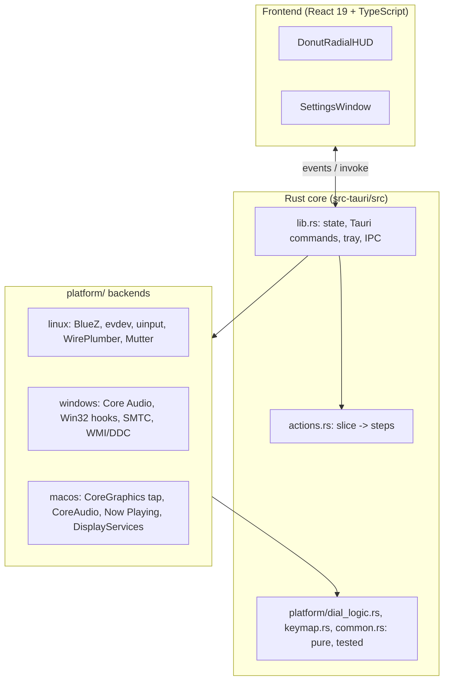

# Architecture

Dial Control is a Tauri v2 application: a Rust daemon owns everything OS-specific, and a React frontend renders two windows (the radial **HUD** and the **Settings** editor). Android is a native Kotlin app that reuses the same React UI in WebViews.

## Why Rust + Tauri

| Need | Choice |
|---|---|
| Small, always-running tray daemon | Rust core, ~20-30 MB idle RAM, ~15 MB binary |
| Transparent, animated overlay | WebView UI (React, Framer Motion, Tailwind) |
| Low-level OS access (evdev, COM, CoreGraphics) | Direct FFI / crates with no runtime |
| One codebase, three desktop installers | `tauri build` per OS |

## Layers

## Platform abstraction

`platform/traits.rs` defines the contracts; `platform/mod.rs` picks the backend at compile time.

| Subsystem | Trait | Windows | Linux | macOS |
|---|---|---|---|---|
| Audio | `SystemAudio` | WASAPI | `wpctl` / `pactl` | CoreAudio |
| Brightness | `SystemBrightness` | DDC/CI + WMI | Mutter D-Bus / sysfs | DisplayServices |
| Active context | `ContextDetector` | `GetForegroundWindow` | GNOME extension / Hyprland / Sway / KDE / X11 | `NSWorkspace` |
| Virtual input | `VirtualInput` | `SendInput` | `/dev/uinput` | `CGEventPost` |
| Dial interception | `DialBackend` | Core Audio callback + hooks + SMTC | BlueZ + exclusive `evdev` grab | Event tap + CoreAudio + Now Playing |

Every backend routes decisions (click vs. multi-press, echo filtering, headroom, key translation) through the pure modules, so they are unit-tested on any host. See [PLATFORMS.md](PLATFORMS.md) for per-OS mechanics.

## Dial model

The earbuds speak plain AVRCP: turns are volume changes, a click is play/pause, double/triple press are Next/Previous. The backend turns those into a gesture state machine (`classify_click`, `classify_multi_press`); while the wheel is open, volume is locked at a baseline with headroom so each turn becomes exactly one detent and the user's real volume is restored on close.

## Configuration

`ProfilesConfig` (`src/types/profile.ts`) holds settings and profiles; each profile has `match_patterns` and ordered slices (`hotkey`, `launch`, `command`, `text`, `macro`, `mode`, `key`, `mute`, `home`, `profile`, `close`, plus Android-only `system`). Defaults live in `src/data/defaultProfiles.ts`; the user's copy is `profiles.json` in the OS app-config directory, hot-reloaded on save. Slice execution (`actions.rs`) reduces every type to a list of steps run on a worker thread after the HUD hides.

## Release pipeline

`release.yml` runs on `v*` tags: verify versions, build Linux/Windows/macOS installers in parallel, then draft a GitHub Release with the changelog as notes (see the [development guide](DEVELOPMENT_GUIDE.md#8-creating-a-release-automated)). `build-windows.yml`, `build-macos.yml` and `build-android.yml` stay manual (`workflow_dispatch`) for one-off builds. Linux packages can also be built locally with `scripts/build-packages.sh`.
