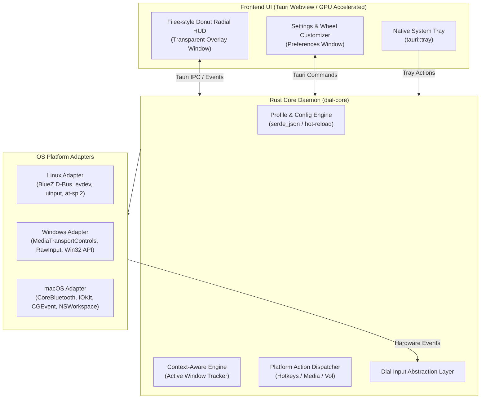

# Cross-Platform Architecture Specification (Linux, Windows, macOS)

## 1. Executive Summary & Tech Stack Selection

To release **Dial Control** as a flagship open-source project with native, ultra-lightweight builds for **Linux**, **Windows**, and **macOS**, the recommended technology stack is **Rust + Tauri v2**.

### Tech Stack Comparison Matrix

| Metric / Capability | **Rust + Tauri v2 (Recommended)** | **C# + Avalonia (Filee's Stack)** | **Pure Python** | **Rust + Slint / Iced** |
|---|---|---|---|---|
| **RAM Footprint (Idle)** | **~20 – 30 MB** | ~280 – 350 MB (.NET CLR) | ~80 – 130 MB | **~15 – 25 MB** |
| **Executable Binary Size**| **~8 – 15 MB** | ~60 – 90 MB (Self-contained) | ~70 – 110 MB (PyInstaller) | **~10 – 20 MB** |
| **Animation Quality** | **10/10** (CSS Springs, Canvas, GPU blur) | **9/10** (Skia / Composition) | 5/10 (Tkinter / CPU raster) | 7/10 (Basic vector paths) |
| **System Tray Support** | First-class (`tauri::tray`) | First-class (TrayIcon) | Platform-fragmented | Requires external crates |
| **Transparent Overlays**| Native borderless + acrylic/vibrancy | Supported | X11/Wayland friction | Compositor quirks |
| **Multi-OS Packaging** | Single `cargo tauri build` for all 3 | `dotnet publish` | Difficult macOS notarization | Manual CI scripts |

---

## 2. Multi-Platform System Architecture



---

## 3. Platform-Specific Implementations

### A. Context Awareness (Foreground App Detection)

| Platform | Mechanism | Rust Crate / API | Latency |
|---|---|---|---|
| **Linux** | At-Spi2 accessibility tree & GNOME window introspection | `atspi` / `zbus` | < 1 ms |
| **Windows** | `GetForegroundWindow()` + `GetWindowModuleFileNameW()` | `windows::Win32::UI::WindowsAndMessaging` | < 0.2 ms |
| **macOS** | `NSWorkspace.shared.frontmostApplication` | `cocoa` / `objc2` | < 0.5 ms |

### B. Hardware Dial Input & Interception

| Platform | Click Interception | Rotation Detection | Volume Lock / Feedback |
|---|---|---|---|
| **Linux** | Linux kernel `EVIOCGRAB` on `/dev/input/event*` | BlueZ `MediaTransport1.Volume` D-Bus signal | D-Bus volume reset echo suppression |
| **Windows** | Low-Level Keyboard / RawInput Hook (`WH_KEYBOARD_LL`) | Windows `GlobalSystemMediaTransportControlsSessionManager` | Win32 Audio Endpoint Volume API |
| **macOS** | Quartz Event Tap (`CGEventTapCreate`) | `MPRemoteCommandCenter` / CoreAudio listener | CoreAudio HAL listener |

### C. Action & Hotkey Emulation

- **Linux**: Direct kernel virtual keyboard via Linux `uinput` (`KEY_PLAYPAUSE`, `KEY_BRIGHTNESSUP`, arbitrary hotkeys like `Ctrl+C`).
- **Windows**: `SendInput` API emitting virtual scan codes (`VK_MEDIA_PLAY_PAUSE`, `VK_VOLUME_UP`, `VK_SNAPSHOT`, etc.).
- **macOS**: `CGEventCreateKeyboardEvent` / `CGEventPost(kCGHIDEventTap, ...)`.

---

## 4. Configuration Schema (`profiles.json`)

```json
{
  "$schema": "./schema.json",
  "settings": {
    "theme": "dark_glass",
    "dial_radius": 180,
    "donut_thickness": 60,
    "sensitivity": 1.0,
    "animation_speed": "smooth",
    "haptic_beep": true,
    "start_in_tray": true,
    "auto_close_seconds": 6
  },
  "profiles": {
    "default": {
      "name": "System Controls",
      "icon": "⚙️",
      "match_patterns": ["*"],
      "actions": [
        { "id": "volume_mode", "label": "Volume", "icon": "🔊", "type": "mode" },
        { "id": "brightness_mode", "label": "Brightness", "icon": "☀️", "type": "mode" },
        { "id": "media_playpause", "label": "Play / Pause", "icon": "⏯️", "type": "key", "action": "playpause" }
      ]
    },
    "file_manager": {
      "name": "Files & Folders",
      "icon": "📁",
      "match_patterns": ["*nautilus*", "*dolphin*", "*explorer*", "*finder*"],
      "actions": [
        { "id": "copy", "label": "Copy", "icon": "📋", "type": "hotkey", "keys": ["CTRL", "C"] },
        { "id": "paste", "label": "Paste", "icon": "📥", "type": "hotkey", "keys": ["CTRL", "V"] },
        { "id": "trash", "label": "Trash", "icon": "🗑️", "type": "hotkey", "keys": ["DELETE"] }
      ]
    }
  }
}
```

---

## 5. GitHub Actions Release Pipeline (Multi-OS Binaries)

```yaml
name: Release Builds (Linux, Windows, macOS)
on:
  push:
    tags:
      - 'v*'

jobs:
  build:
    strategy:
      fail-fast: false
      matrix:
        include:
          - platform: 'macos-latest'
            args: '--target universal-apple-darwin'
          - platform: 'ubuntu-22.04'
            args: ''
          - platform: 'windows-latest'
            args: ''
    runs-on: ${{ matrix.platform }}
    steps:
      - uses: actions/checkout@v4
      - uses: dtolnay/rust-toolchain@stable
      - uses: pnpm/action-setup@v2
      - run: pnpm install
      - uses: tauri-apps/tauri-action@v0
        env:
          GITHUB_TOKEN: ${{ secrets.GITHUB_TOKEN }}
        with:
          tagName: v__VERSION__
          releaseName: 'Dial Control v__VERSION__'
          releaseBody: 'Cross-platform native release for Linux (.deb, .rpm, .AppImage), Windows (.msi, .exe), and macOS (.dmg).'
          releaseDraft: true
          prerelease: false
          args: ${{ matrix.args }}
```
